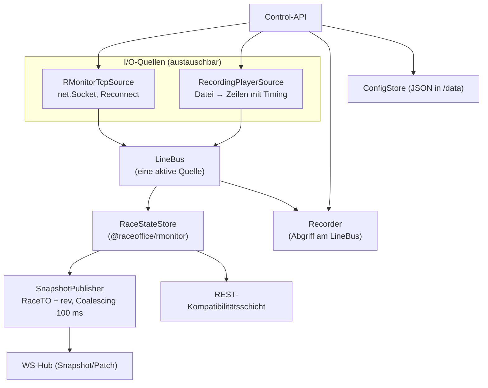
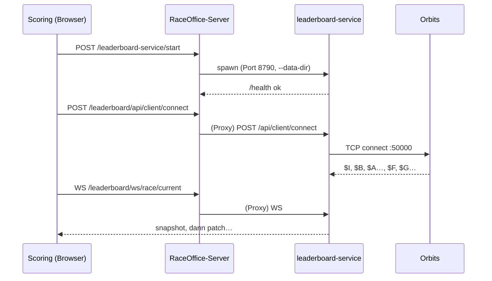

# 02 – Zielarchitektur

## 1. Neue Workspaces

| Workspace | Art | Verantwortung |
|---|---|---|
| `packages/rmonitor` | Bibliothek, reines TS ohne I/O | Tokenizer, Parser je Nachrichtentyp, `RaceStateStore`, `toRaceTO()`, Zeitformat, Reader/Writer für Recordings |
| `apps/leaderboard-service` | Node-Prozess (Fastify 5, `@fastify/websocket`) | RMonitor-TCP-Client, REST/WS/Control-API, Recorder, Player, Auslieferung des Frontends, Konfiguration |
| `apps/leaderboard-frontend` | React 19 + Vite + MUI 9 | Leaderboard, Control Center, Start Signal, Lap Counter, Finish Line Log |

Erweitert werden:

| Bestehend | Erweiterung |
|---|---|
| `packages/domain/src/raceStatusFeed.ts` | optionale Felder `trackName`, `trackLength`, `bestLap`, `lastLap`, `qualiPosition`; WS-Nachrichtentypen; Typen für Status und Steuerung |
| `apps/server` | `LeaderboardServiceManager`, Routen, Proxy `/leaderboard/*` (siehe [05-worker-und-steuerung.md](05-worker-und-steuerung.md)) |
| `apps/frontend` | `RaceStatusProvider` mit WS-Transport; Service-Steuerung im Settings-Dialog von `LiveRaceStatus` |
| `scripts/deploy.mjs` | Leaderboard-Service mit ausliefern |

**Warum ein eigenes Paket `rmonitor`?** Parser und Zustandsmodell sind reine Logik. Getrennt vom I/O lassen sie sich deterministisch testen, auch mit Golden-Tests gegen Recordings. Außerdem sind sie wiederverwendbar, etwa für einen späteren Import von Orbits-Mitschnitten ins Scoring. Das entspricht dem Muster von `packages/p3parser`.

---

## 2. Schichten im Service

- **Quellen:** TCP-Client und Player liefern beide Zeilen in denselben `LineBus`. Aktiv ist immer genau eine Quelle.
  - Das ersetzt den TCP-Umweg der Java-App, wo der Player ein Server war und der Client sich mit ihm verband.
  - Ein optionaler TCP-Replay-Server bleibt für externe Tests verfügbar, siehe [04-service-api.md](04-service-api.md).
- **Recorder:** zeichnet am `LineBus` auf, also unabhängig von der Quelle.
- **SnapshotPublisher:**
  - erzeugt nach Änderungen gebündelt (Coalescing) den aktuellen `RaceTO`
  - führt eine Revision pro Rennen und berechnet Diffs gegen den letzten Snapshot
- **ConfigStore:** `leaderboard.config.json` im Datenverzeichnis. Vorrang: CLI > ENV > Datei > Default.

---

## 3. Betriebsmodi

| | Modus A – managed | Modus B – standalone |
|---|---|---|
| Start | RaceOffice-Server startet `node apps/leaderboard-service/dist/index.js` | `docker run …` oder manuell `node dist/index.js` |
| Erreichbarkeit | über den RaceOffice-Server: `/leaderboard/*` (Proxy) | direkt, z. B. `http://host:8080` |
| Port | intern, z. B. `127.0.0.1:8790` | `8080` (Java-kompatibel) |
| Steuerung | Start/Stop des Prozesses durch den RaceOffice-Server; Orbits/Recorder/Player über die Control-API | Control-API direkt bzw. eigenes Control Center |
| Frontend | unter `/leaderboard/ui/` (vom Service ausgeliefert, durch den Proxy) | unter `/ui/` (Browser-Aufruf von `/` leitet um) |
| Zweck | Normalbetrieb mit RaceOffice auf einem Rechner, kein separater Start mehr | Ersatz der Java-App, getrennte Hardware, Docker-Hosts, Betrieb ohne RaceOffice |

Beide Modi nutzen **dasselbe Artefakt**. Der RaceOffice-Server kennt drei Einstellungen:
- `LEADERBOARD_MODE=managed`
- `external`: Proxy auf `LEADERBOARD_URL`, kein Prozessmanagement
- `off`: Verhalten wie heute, Polling auf eine konfigurierte URL

---

## 4. Architekturregeln

1. **Der Leaderboard-Service hängt nicht vom RaceOffice-Server ab.** Er funktioniert vollständig allein (Modus B). Der RaceOffice-Server ist nur Starter und Proxy.
2. **REST-Kompatibilität ist ein Vertrag.** Pfade, Feldnamen und Zeitformate bleiben 1:1 wie in der Java-App. Neue Felder dürfen nur hinzukommen.
3. **`packages/rmonitor` ist frei von I/O.** Kein `net`, kein `fs`, kein Timer im Kern, damit die Tests deterministisch bleiben.
4. **Anfangs kein Persistieren von Rennen** in RaceOffice (entschieden). Das Scoring übernimmt weiterhin selbst, was es braucht (Sync-Logik in `liveScoring.ts`). Eine spätere Speicherung ist als Ausbaustufe vorgemerkt, siehe [08-umsetzungsplan.md](08-umsetzungsplan.md).
5. **Genau eine Orbits-Quelle gleichzeitig.** Live und Replay schließen sich gegenseitig aus.
6. **`RaceStatusProvider` behält seine Context-Schnittstelle.** Damit bleiben `LiveRaceStatus`, `ScoringViewModel` und `liveScoring.ts` unverändert.

---

## 5. Alternativen (verworfen)

| Alternative | Grund der Ablehnung |
|---|---|
| RMonitor-Client direkt im RaceOffice-Server | Kein schlanker Docker-Ersatz für die Java-App. Ein Fehler im TCP-Handling würde den Hauptserver treffen. |
| Steuerung über Realtime-Doc-Command-Queue (wie livetracking-worker) | Standalone-Betrieb bräuchte dann trotzdem den RaceOffice-Server. Für eine einzelne Quelle ist REST einfacher. |
| Java-App behalten und nur ein WS-Bridge-Proxy davor | Löst weder das Startproblem noch den Wunsch nach einer Web-UI |
