# 08 – Umsetzungsplan

## Implementierungsstatus

| Komponente | Status |
|---|---|
| Konzept (`doc/leaderboard-integration/`) | **fertig** |
| `packages/rmonitor` | **fertig**: Parser, Store, `toRaceTO`, Recording-Format, `LineDecoder`, `FakeOrbitsFeeder`. Golden-Tests für 6 Aufnahmen ohne Abweichung. |
| Domain: optionale `RaceTO`-Felder, `leaderboardProtocol.ts` | **fertig** (nur Typen) |
| `apps/leaderboard-service` (headless, Docker) | offen |
| RaceOffice-Integration (Manager, Proxy, WS im Scoring) | offen |
| `apps/leaderboard-frontend`: Leaderboard + Control Center | offen |
| Start Signal, Lap Counter, Finish Line Log | offen |
| Deployment, Release, Ablösung der Java-App | offen |

---

## Phasen

### P1 – `packages/rmonitor` (Fundament)
- Tokenizer, Duration-Parse/Format, alle Parser (`$A`/`$COMP`, `$B`, `$C`, `$E`, `$F`, `$G`, `$H`, `$I`, `$J`, `$SP`/`$SR`)
- `RaceStateStore`, `toRaceTO()`, Recording-Format
- Port der JUnit-Tests nach vitest
- Fixtures: Recordings aus dem Java-Repo und weitere lokale Aufnahmen nach `packages/rmonitor/test/fixtures/recordings/`
- Fake-Orbits-Feeder (Node-TCP-Server): spielt ein Recording zeilengenau ab, hält an Zeilennummern an und lässt sich programmatisch weiterschalten. Er wird in P2 für die Service-Integrationstests wiederverwendet.
- Golden-Test-Harness: Skript startet die Java-App headless als Client und Server gegen den Feeder (nicht gegen den Java-Player), zieht `/races` an den Haltepunkten und speichert die Fixtures; dazu die Vergleichstests (Details in [03-rmonitor-port.md](03-rmonitor-port.md#6-teststrategie))
- Erweiterung `packages/domain/src/raceStatusFeed.ts` (optionale Felder) und neues `leaderboardProtocol.ts`

**Fertig, wenn:** Alle Golden-Tests sind grün, oder jede Abweichung ist dokumentiert und begründet.

### P2 – `apps/leaderboard-service` headless → **Meilenstein: ersetzt die Java-App**
- `RMonitorTcpSource` (Reconnect, Encoding, Chunking), `LineBus`, `Recorder`, `RecordingPlayerSource`
- REST-Kompatibilitätsschicht, `SnapshotPublisher` + WS `/ws/race/*`, `/ws/status`
- Control-API inkl. Recordings-Upload/-Download, ConfigStore, CLI/ENV, optionaler Token
- Optional: TCP-Replay-Server
- Dockerfile, compose-Beispiel, Bundle (tsup/esbuild)
- Integrationstests:
  - Fake-Orbits-Feeder aus P1 (Recording) → Service → REST/WS-Assertions
  - Reconnect-Szenarien
  - Früher Smoke-Test, solange `RecordingPlayerSource` noch fehlt: Der **Java-Player** (`--headless -p --player-file … --player-stream-encoding windows-1252`) dient als TCP-Quelle für `RMonitorTcpSource`

**Fertig, wenn:** Das bestehende Scoring läuft unverändert gegen den Container (`/races?filter=current`).

### P3 – Integration in RaceOffice
- `ManagedProcess` (optionaler Refactor von `LiveTrackingWorkerManager`) und `LeaderboardServiceManager`
- Routen `/leaderboard-service/*`, Proxy `/leaderboard/*` (HTTP + WS), Server-Konfiguration `LEADERBOARD_MODE`/`URL`
- `RaceStatusProvider`: WS-Transport mit Polling-Fallback, neue Default-URL. Entscheidung zur Stale-Erkennung im WS-Modus.
- `leaderboardServiceClient.ts`, Dialog „Live-Quelle“ in `LiveRaceStatus`, REPLAY-Hinweis

**Fertig, wenn:** Das Scoring startet den Service, verbindet Orbits und wertet per WS. Ohne Service bleibt das Verhalten wie heute.

### P4 – Leaderboard-Frontend: Leaderboard + Control Center
- App-Gerüst, `useLeaderboardStream`, `useServiceStatus`, App-Leiste
- Leaderboard mit Spaltenauswahl, Presets, Gap/Interval, Animationen, Kiosk/Fullscreen, Dark Mode
- Control Center mit vier Karten
- Gemeinsame Formatierungshelfer nach `packages/domain` verschieben (aus `LiveRaceStatus.tsx`, `liveTime.ts`)

### P5 – Weitere Sichten
- Start Signal, Lap Counter (mit Delay), Finish Line Log (Passings-Ringpuffer im Service + WS-Kanal)

### P6 – Deployment und Ablösung
- `scripts/deploy.mjs`, `doc/build-and-deploy.md`, CI/Release inkl. Multi-Arch-Image
- Parallelbetrieb mit Vergleichsskript bei einer echten Veranstaltung, danach Abschaltung der Java-App

```mermaid
gantt
  dateFormat X
  axisFormat %s
  section Kern
  P1 rmonitor           :p1, 0, 3
  P2 Service + Docker   :p2, after p1, 4
  section Integration
  P3 RaceOffice         :p3, after p2, 3
  P4 Frontend Kern      :p4, after p2, 4
  P5 Weitere Sichten    :p5, after p4, 2
  P6 Deployment         :p6, after p3, 2
```

*(Relative Aufwände; P3 und P4 können parallel laufen.)*

---

## Teststrategie (Überblick)

| Ebene | Werkzeug | Inhalt |
|---|---|---|
| Parser/Modell | vitest | Port der JUnit-Tests, Robustheit (Chunking, kaputte Zeilen, Zeilenenden, windows-1252) |
| Kompatibilität | vitest + Fixtures | Golden-Tests gegen Java-Referenz-Snapshots, erzeugt mit Fake-Orbits-Feeder → Java-App an festen Zeilennummern |
| Service | vitest + Fastify `inject` + Fake-Orbits-Feeder | REST, WS (Snapshot/Patch/Resync), Control-API, Player-Seek |
| Integration RaceOffice | vitest (`packages/test-utils`) | Manager-Start/Stop, Proxy inkl. WS, Fallback auf Polling |
| Frontend | vitest + Testing Library | Patch-Anwendung, Spaltenlogik, Lap-Counter-Delay |
| End-to-End | manuell / Recording | Recording → Player (Java-Player oder eigener) → Scoring-Sync einer Elimination und eines Punkterennens |

**Rolle des Java-Players:** Er eignet sich für manuelle und End-to-End-Tests und als frühe TCP-Quelle in P2. Für Golden-Snapshots eignet er sich nicht: Er spielt nach Wanduhrzeit ab, lässt sich headless weder anhalten noch an eine Position setzen und verrät nicht, welche Zeile er zuletzt gesendet hat. Encoding immer explizit auf `windows-1252` setzen.

---

## Risiken

| Risiko | Gegenmaßnahme |
|---|---|
| Feinheiten bei Zeitformat und Flag-Mapping weichen von Java ab, das Scoring rechnet falsch | Golden-Tests; `parseTimeToSeconds` gegen alle Formate testen |
| Zeichenkodierung (Umlaute in Namen) | Encoding konfigurierbar, Default `windows-1252`, fester Test mit `leaderboard-recording_AGI_2022_pts_Sen_Men.txt` (enthält windows-1252-Umlaute) |
| Golden-Referenz nicht reproduzierbar (Timing, JVM-Default-Encoding) | Feeder mit Haltepunkten statt Java-Player; Java-App mit explizitem Encoding und eigenem Arbeitsverzeichnis |
| Flaggen außer `Green` und leer sind in den vorhandenen Aufnahmen nicht belegt | Weitere lokale Aufnahmen (Yellow/Red/Finish/Purple, Rennwechsel) als Fixtures aufnehmen |
| Heartbeat-Timing geht verloren (z. B. Unterdrückung „leerer“ Patches) | Test: Bei Replay in Echtzeit kommt mindestens ein Patch pro Sekunde beim Client an |
| Der WS-Proxy im RaceOffice-Server wird zum Engpass | Sehr geringe Datenrate (≤ 10 Patches/s). Leaderboard-Bildschirme können direkt auf den Service zeigen. |
| Docker-Netzwerk ↔ Orbits (Firewall, `host.docker.internal`) | Dokumentation, Connection-Verlauf im Control Center |

---

## Entscheidungen

| Thema | Entscheidung |
|---|---|
| Auth | Ein optionaler Control-Token (`LEADERBOARD_CONTROL_TOKEN`) reicht |
| Orbits-Quellen | Immer nur **eine** Quelle gleichzeitig |
| Parallelbetrieb | Orbits bedient mehrere Clients; Java-App und neuer Service können für den Vergleich gleichzeitig verbunden sein |
| Persistenz | Anfangs **keine** Speicherung von Rennen in RaceOffice |
| Recordings | Aufnahmen aus dem Java-Repo dürfen verwendet werden; weitere lokale Aufnahmen kommen hinzu |
| Stale-Erkennung | Der `$F`-Heartbeat von Orbits kommt jede Sekunde und erzeugt mindestens einen Patch pro Sekunde. Die bestehende 3-s-Regel in `LiveRaceStatus` bleibt, kein künstlicher Keepalive. |

## Offene Punkte

1. **Bündelung:** Service als Single-File-Bundle (Empfehlung) oder klassisch mit `node_modules`?
2. **Name des Images:** z. B. `raceoffice-leaderboard`, Registry `ghcr.io`.
3. **Später:** Speicherung abgeschlossener Rennen (`RaceTO` bei FINISH) für Nachkontrolle und Export.
