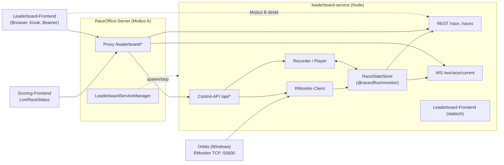

# Leaderboard-Integration: RMonitorLeaderboard → TypeScript

## Ziel
Das Scoring zeigt das laufende Rennen über `LiveRaceStatus` an. Die Daten pollt der Browser über `RaceStatusProvider` von der Java-Anwendung [RMonitorLeaderboard](https://github.com/bastianpaetzold/RMonitorLeaderboard) (`http://localhost:8080/races?filter=current`). Diese Java/Swing-Anwendung muss heute immer separat gestartet werden.

Ziel ist, RMonitorLeaderboard nach TypeScript zu überführen und in raceoffice2 zu integrieren:

1. **Leaderboard-Service**
   - empfängt den Rennstatus von Orbits (RMonitor-Protokoll über TCP)
   - bietet ihn wie bisher als **REST-API** an
   - liefert ihn zusätzlich per **WebSocket als Diffs** (Snapshot + JSON-Patch)
2. **Eigenständiges Web-Frontend**, das funktional den Swing-Sichten entspricht. UI und Usability werden dabei deutlich verbessert.
3. **Betrieb als Worker auf dem Server**, steuerbar aus dem Scoring und aus dem Leaderboard.
4. **Headless im Docker-Container lauffähig**, damit die Java-Anwendung komplett ersetzt werden kann.

---

## Getroffene Entscheidungen

| Thema | Entscheidung |
|---|---|
| Betriebsmodell | **Ein Service, zwei Modi**. Modus A *managed*: Der RaceOffice-Server startet den Service als Worker und erreicht ihn per Proxy unter `/leaderboard`. Modus B *standalone*: eigener Docker-Container als 1:1-Ersatz der Java-App. |
| REST-API | Drop-in-kompatibel zu RMonitorLeaderboard: gleiche Pfade, gleiches JSON, Port 8080 |
| Live-Updates | Zusätzlicher WebSocket mit Snapshot und JSON-Patch-Diffs (Muster wie `realtimeHub`) |
| Sichten | Alle Swing-Sichten, in Phasen, **ohne Estimator** |
| Control Center | Connection, Server-Status, Recorder und Player werden auf **einer** Seite zusammengefasst |
| Design | Funktional gleichwertig, UI und Usability dürfen (und sollen) besser werden, auch beim Leaderboard |
| Orbits-Quelle | Immer genau eine. Orbits bedient mehrere Clients, Parallelbetrieb mit der Java-App ist möglich. |
| Lebenszeichen | Der `$F`-Heartbeat kommt jede Sekunde und erzeugt mindestens einen Patch pro Sekunde; die 3-s-Stale-Regel im Scoring bleibt |
| Absicherung | Optionaler Control-Token für schreibende Endpunkte |
| Persistenz | Anfangs keine Speicherung von Rennen |
| Sprache/Stack | TypeScript, Node ≥ 20.19, Fastify 5, React 19, Vite, MUI 9 (wie die übrigen Apps) |

---

## Überblick

---

## Dokumente

| Dokument | Inhalt |
|---|---|
| [01-ist-analyse.md](01-ist-analyse.md) | Analyse von RMonitorLeaderboard: Protokoll, Modell, REST, Swing-Sichten, CLI, Bugs |
| [02-zielarchitektur.md](02-zielarchitektur.md) | Komponenten, neue Workspaces, Betriebsmodi A/B, Datenfluss |
| [03-rmonitor-port.md](03-rmonitor-port.md) | Port von Parser und Zustandsmodell nach TypeScript, Kompatibilität, Golden-Tests |
| [04-service-api.md](04-service-api.md) | REST (kompatibel), WebSocket-Diff-Protokoll, Control-API |
| [05-worker-und-steuerung.md](05-worker-und-steuerung.md) | Managed-Modus im RaceOffice-Server, Steuerung aus Scoring und Leaderboard |
| [06-frontend.md](06-frontend.md) | Sichten, UX-Konzept, Control Center |
| [07-docker-und-deployment.md](07-docker-und-deployment.md) | Docker-Image, compose, deploy.mjs, Ablösung der Java-App |
| [08-umsetzungsplan.md](08-umsetzungsplan.md) | Phasen, Arbeitspakete, Tests, Risiken, offene Punkte |

---

## Glossar

| Begriff | Bedeutung |
|---|---|
| **Orbits** | Zeitnahme-Software von MYLAPS. Sie gibt den Rennstatus über das RMonitor-Protokoll aus. |
| **RMonitor** | Zeilenbasiertes ASCII/CSV-Protokoll über TCP (Default-Port 50000), Nachrichten `$A`…`$J`, `$F` (Heartbeat) usw. |
| **RaceTO** | JSON-Transferobjekt eines Rennens, wie es RMonitorLeaderboard über REST liefert. Im Domain-Paket heißt es `RaceStatusRace`. |
| **Recording** | Mitschnitt des RMonitor-Streams, eine Zeile pro Nachricht: `<ms seit Start> <Rohzeile>` |
| **Player** | Spielt ein Recording mit einstellbarer Geschwindigkeit ab (Test, Schulung, Nachbereitung). |
| **Modus A / B** | *managed* (vom RaceOffice-Server gestartet) / *standalone* (eigener Container bzw. Prozess) |
