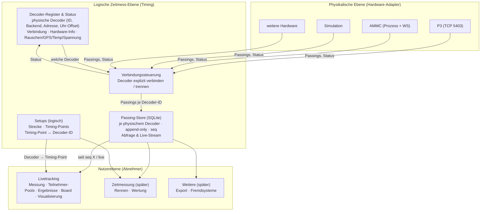
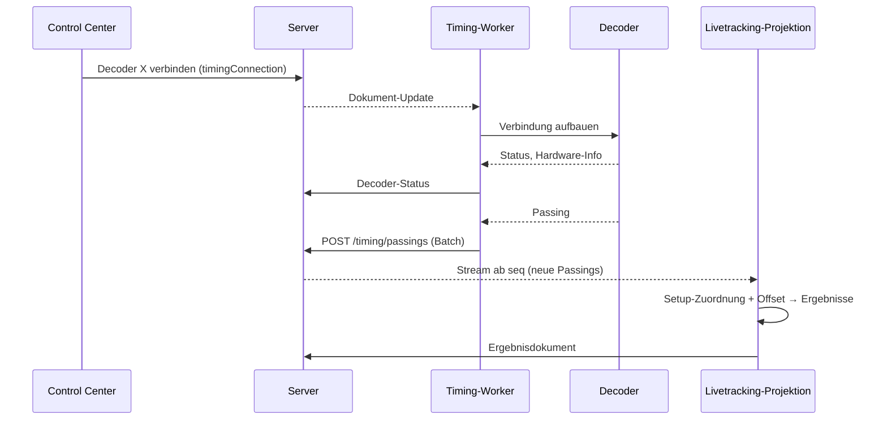

# Zeitmess-Plattform – Schichtenarchitektur

Dieses Dokument beschreibt die Zielarchitektur für Zeitmess-Hardware, Passings und deren Abnehmer in RaceOffice. Es ist die Referenz für alle weiteren Arbeiten an Livetracking, Decoder-Anbindung und einer späteren vollständigen Zeitmessung.

- **Status:** Phasen 0–3 umgesetzt (Branch `livetracking-control-center`), siehe [Migrationspfad](#8-migrationspfad-vom-ist-zustand).
- **Verwandt:** [architecture.md](architecture.md) (Realtime-Dokumentmodell), [livetracking-decoder-backend-plan.md](livetracking-decoder-backend-plan.md) (Adapter-Schicht AMMC/P3).

---

## 1. Ziel

Es gibt eine **zentrale Zeitmess-Ebene**:
- Sie steuert die Hardware, erzeugt Passings, speichert sie dauerhaft und stellt sie **mehreren Abnehmern** bereit.
- Abnehmer sind heute das Livetracking und später eine vollständige Zeitmessung mit Rennen und Wertung, Exporte oder Fremdsysteme.
- Abnehmer verwalten ihre eigenen Messungen und Ergebnisse. Sie können diese löschen, ohne die Passings oder die Daten anderer Abnehmer anzutasten.

Heute steckt alles in einem Livetracking-Worker und einem Setup-Dokument: Hardware-Anbindung, Passing-Erzeugung, Streckenbeschreibung, Messablauf und Ergebnisberechnung. Diese Architektur trennt das in drei Schichten.

---

## 2. Schichten

### 2.1 Physikalische Ebene (Hardware-Adapter)
- Je Hardware-Typ gibt es einen Adapter hinter dem Interface `DecoderSourceAdapter` (`apps/livetracking-worker/src/decoder/adapters/decoderSourceAdapter.ts`). Heute sind das P3 (direkt per TCP über `@raceoffice/p3parser`), AMMC (externer Prozess und WebSocket) und eine Simulation.
- Ein Adapter kennt nur **physische Decoder**: Adresse, Protokoll, Uhr. Von Strecken, Timing-Points oder Rennen weiß er nichts.
- Er liefert zwei Arten von Daten:
  - normalisierte Passings: Decoder-ID, Decoder-Zeit, Transponder, Signal, Rohdaten
  - Status: Verbindung, Hardware-Info, bei P3 Rauschen, GPS-Lock, Temperatur und Spannung
- **Neue Hardware** = neuer Adapter, der dieses Interface erfüllt. Darüberliegende Schichten bleiben unverändert.

### 2.1b AMMC-Anbindung
- Für jeden verbundenen AMMC-Decoder startet der Worker den Konverter `ammc-amb --websocket <lokaler Port> <Decoder-IP>`. Der Konverter erreicht den Decoder auf dem MyLaps-Port 5403. Der Worker liest die Passings über `ws://127.0.0.1:<lokaler Port>`.
- Der **lokale WebSocket-Port** ist keine Eigenschaft des Decoders. Der Worker vergibt ihn automatisch aus einem Bereich (`LIVETRACKING_AMMC_WS_PORT_BASE`, Standard 19000) und zeigt ihn im Hardware-Status als „Konverter-Port“. Früher musste er von Hand eingetragen werden und war Teil der Decoder-ID.
- Ein AMMC-Decoder heißt deshalb `ammc@<IP>`. Alte IDs `ammc@<IP>:<Port>` und `sim@<IP>:<Port>` werden beim Serverstart auf `ammc@<IP>` umgestellt, mehrere Einträge desselben Geräts zusammengeführt. Setups, Verbindungswunsch und gespeicherte Passings folgen der Umbenennung.

### 2.1a Decoder-Simulator
- `ammc-sim` simuliert einen MyLaps-Decoder auf dem Rechner des Timing-Workers. Er lauscht auf dem festen MyLaps-Port 5403, deshalb läuft höchstens ein Simulator pro Rechner.
- Der Simulator **ersetzt die Hardware** und ist kein Decoder-Typ. Ein normaler P3- oder AMMC-Decoder im Register mit Adresse `127.0.0.1` verbindet sich mit ihm wie mit einem echten Gerät, und seine Passings landen ganz normal im Passing-Store.
- Bedienung: Decoder-Seite, Reiter „Simulation“. Dort starten und stoppen, Einstellungen bearbeiten (Decoder-ID mit 6 Hex-Zeichen, Transponder, Abstand der Passings mit Berechnung aus Rundenlänge und Tempo, Startverzögerung, optional Sichtbarkeit im Netzwerk-Scan) und einen Decoder für den Simulator anlegen.
- Gespeichert im Realtime-Dokument `timingSimulator` (Wunsch „läuft“ und Einstellungen). Der Worker startet, stoppt oder startet bei geänderten Einstellungen neu. Der Status steht in `timingStatus.simulator`.
- `ammc-sim` sendet keinen VERSION-Datensatz. Der P3-Adapter erkennt den Decoder deshalb am ersten Passing oder Status-Datensatz.

### 2.2 Logische Zeitmess-Ebene (Timing)
Sie besteht aus vier Bausteinen:

| Baustein | Aufgabe |
|---|---|
| **Decoder-Register** | Liste der physischen Decoder: ID, Name, Backend, Adresse (IP, Port), Uhr-Offset, Simulationsparameter. Dazu der laufende Status je Decoder. Unabhängig von Setups. |
| **Verbindungssteuerung** | Verbindet und trennt Decoder **explizit** (je Decoder oder als Auswahl) und führt die Adapter. |
| **Passing-Store** | Speichert jede Durchfahrt dauerhaft in SQLite, je physischem Decoder, append-only, mit fortlaufender `seq`. Bietet Abfrage und Live-Stream. |
| **Setups** | Logische Streckenbeschreibung: Strecke (Name, Länge), Timing-Points (Position, Rolle, aktiv) und je Timing-Point die zugeordnete **Decoder-ID**. |

### 2.3 Nutzerebene (Abnehmer)
- Ein Abnehmer liest Passings aus dem Passing-Store und übersetzt sie über ein Setup in Durchfahrten an Timing-Points. Daraus berechnet er seine Ergebnisse.
- Er führt eigene **Messungen** und eigene Teilnehmerdaten, beim Livetracking zum Beispiel die Teilnehmer-Pools.
- Mehrere Abnehmer können gleichzeitig dieselben Passings nutzen.

---

## 3. Grundsatz: Physik und Logik sind getrennt

- Der Passing-Store kennt **nur physische Decoder**, keine Setups und keine Timing-Points.
- Jeder physische Decoder hat eine **stabile ID**:
  - die vom Gerät gemeldete Hardware-ID (P3: `decoderId`, z. B. `40-24-04-00`), oder
  - eine generierte ID, wenn das Gerät keine meldet (AMMC, Simulation).
- Ein **Setup ordnet Timing-Points Decoder-IDs zu**. Erst der Abnehmer wendet diese Zuordnung an.
- Folgen:
  - Mehrere Setups können **dieselben Passings** verwenden, z. B. eine zweite Streckeneinteilung mit zusätzlichen Splits oder eine nachträgliche Auswertung mit korrigierter Zuordnung.
  - Ein Decoder kann in mehreren Setups vorkommen.
  - Tauscht man ein Gerät, ändert sich nur die Zuordnung im Setup. Die historischen Passings bleiben dem alten Gerät zugeordnet.
- **Uhr-Offset:** Der Offset eines Decoders steht im Register und wird **beim Lesen** angewendet, über einen gemeinsamen Domain-Helfer. Gespeichert wird die rohe Decoder-Zeit. Ein falsch eingestellter Offset lässt sich so nachträglich korrigieren, ohne Daten umzuschreiben.

---

## 4. Begriffe

| Begriff | Ebene | Bedeutung |
|---|---|---|
| **Physischer Decoder** | Timing | Ein Gerät im Decoder-Register mit stabiler ID. |
| **Verbindungssitzung** | Timing | Zeitraum zwischen explizitem „verbinden“ und „trennen“ eines Decoders. Ab dem Verbinden werden alle Passings dieses Decoders gespeichert. |
| **Passing** | Timing | Unveränderliches Ereignis: `seq`, Decoder-ID, rohe Decoder-Zeit, Zeitquelle, Empfangszeit, Passing-Nummer, Transponder, Signalstärke, Hits, Batterie, Signalart (z. B. Startsignal), Rohdaten. |
| **Setup** | Timing | Logische Strecke mit Timing-Points und deren Zuordnung zu Decoder-IDs. |
| **Messung** | Nutzer | Fenster eines Abnehmers auf den Passing-Store (z. B. ab `startSeq`, bis `stopSeq`), gefiltert auf die Decoder-IDs eines Setups. Ergebnisse gehören zur Messung. |

---

## 5. Regeln

### 5.1 Verbindungsaufbau
- **Nichts verbindet automatisch.** Viele Decoder erlauben nur wenige gleichzeitige Verbindungen, zum Beispiel neben einer Zeitmess-Software. Das Verbinden ist deshalb immer eine bewusste Bedienhandlung.
- Läuft der Worker, heißt das noch nicht, dass Decoder verbunden sind. Ein Neustart des Workers stellt den zuletzt **gewünschten** Verbindungszustand wieder her, der Wunsch ist im Dokument gespeichert.

### 5.2 Persistenz
- Passings werden ab dem Verbinden in einer SQLite-Tabelle des RaceOffice-Servers gespeichert, neben der Dokumenttabelle `docs`, nicht als Realtime-Dokument.
- Grund: Ein Realtime-Dokument wird bei jeder Änderung vollständig gelesen und neu geschrieben. Bei zehntausenden Passings eines Wettkampftages skaliert das nicht und erlaubt keine Abfragen nach Decoder oder Zeitraum.
- Die Tabelle ist append-only. Die `seq` steigt streng monoton und ist die Grundlage für Messfenster und Nachlieferung.
- Das Schreiben ist idempotent über eine stabile Passing-ID, damit ein wiederholter Upload nach einem Fehler keine Duplikate erzeugt.

### 5.3 Löschen
- **Passings** werden nur auf der Timing-Ebene gelöscht: bewusst, mit Filter (Decoder, Zeitraum oder alles) und mit Rückfrage. Abnehmer werden darüber informiert und rechnen neu.
- **Messungen und Ergebnisse** löscht jeder Abnehmer selbst, beim Livetracking mit „Messung zurücksetzen“. Die Passings und die Messungen anderer Abnehmer bleiben dabei unberührt.

### 5.4 Vollständigkeit (P3: fehlende Passings nachfordern)
P3-Decoder nummerieren ihre Passings fortlaufend und halten sie im Speicher. Die Timing-Ebene sorgt dafür, dass keine Durchfahrt verloren geht:
- **Lücke im laufenden Betrieb:** Folgt auf Nummer 41 die 44, fordert der Worker 42–43 per RESEND nach. Kommen sie nach 5 s nicht, fragt er erneut, höchstens dreimal.
- **Nach jedem (Wieder-)Verbinden:** Der Worker fragt per SESSION die letzte Passing-Nummer des Decoders ab und fordert alles ab der höchsten im Passing-Store gespeicherten Nummer + 1 nach, höchstens 2 000 auf einmal. So werden auch Durchfahrten während eines Ausfalls nachgeholt.
- **Erster Kontakt** mit einem Decoder (nichts gespeichert): Es wird nichts nachgeholt, der Decoder-Speicher bleibt unangetastet.
- **Neustart des Decoders:** Ist die gemeldete letzte Nummer kleiner als die gespeicherte, wurde der Speicher zurückgesetzt. Dann wird nichts angefordert, die Zählung beginnt neu.
- **Doppelte Passings:** Nachgeforderte Passings, die schon da sind, landen nicht doppelt im Store. Das Schreiben ist idempotent über die Passing-ID, die die Passing-Nummer enthält.
- **Statusanzeige:** Der Decoder-Status zeigt angefordert / wiederhergestellt / offen. „Offen > 0“ nach allen Versuchen heißt: Es fehlen Passings.
- **Technik:** Für SESSION und RESEND wird die Decoder-ID in Protokoll-Reihenfolge gesendet (`decoderIdToRequestOrder` in `@raceoffice/p3parser`, siehe [p3test-client-notes.md](p3test-client-notes.md)).

### 5.5 Status und Diagnose
- Je Decoder werden geführt:
  - Verbindungszustand, letzte Meldung, letzter Fehler, Zahl der Passings
  - Hardware-Info (ID, Typ, Firmware)
  - Gerätestatus, soweit das Protokoll ihn liefert: P3 meldet Rauschen, GPS-Lock, Temperatur und Spannung (`DecoderStatusEvent`)
- Eine Warnung erscheint bei Stille über 30 s (P3 sendet regelmäßig Status und Sync-Pulse), bei fehlendem GPS-Lock und bei Verbindungsfehlern.

---

## 6. Prozesse und Datenfluss

| Prozess | Rolle |
|---|---|
| **Timing-Worker** (hervorgegangen aus `apps/livetracking-worker`) | Physikalische Ebene und Verbindungssteuerung. Hardware-I/O läuft in einem eigenen Prozess: Ein hängender oder abstürzender Adapter trifft den Server nicht. |
| **RaceOffice-Server** (`apps/server`) | Passing-Store (Tabelle und API), Decoder-Register, Setups, Verbindungs-Dokument, Realtime-Verteilung. |
| **Livetracking-Projektion** | Abnehmer. Zunächst ein eigenes Modul im Worker-Prozess ohne Hardware-Abhängigkeit, später als eigener Prozess oder im Server möglich. |

**Geplante Schnittstellen der Timing-Ebene** (Server):
- `POST /timing/passings`: Batch vom Worker, idempotent über die Passing-ID
- `GET /timing/passings?sinceSeq&limit&decoderIds&from&to`: Abfrage
- `DELETE /timing/passings?…`: Löschen mit Filter, nur mit ausdrücklicher Bestätigung
- WS `/timing/passings/stream?sinceSeq`: erst Nachlieferung, dann live
- Realtime-Dokumente `timingDecoders` (Register und Status) und `timingConnection` (gewünschter Verbindungszustand je Decoder)

---

## 7. Bedienung (Oberfläche)

Zwei klar getrennte Bereiche, zunächst in `apps/livetracking-frontend`:

**Zeitmessung**
- **Control Center:**
  - Worker starten/stoppen
  - Hardware-Tabelle je physischem Decoder: verbinden/trennen, Status, Hardware-Info, P3-Gerätestatus, Warnungen, Zusammenfassung „2 von 3 verbunden“
  - Passing-Log mit Filter, Gesamtzahl, „Passings löschen …“
  - Diagnose
- **Decoder:** Register pflegen, inklusive Übernahme aus dem P3-Netzwerk-Scan.
- **Setups:** Strecke und Timing-Points, je Timing-Point Auswahl eines Decoders.

- **Aktives Setup** (Control Center): Hier wird das Setup gewählt. Seine Decoder werden angezeigt und lassen sich verbinden („Decoder des Setups verbinden“ oder „Nur diese verbinden“). Gespeichert ist es in `timingConnection.activeSetupId`. Die Livetracking-Messung übernimmt es, es gibt also nur eine Stelle zur Auswahl. Während einer Messung lässt es sich nicht ändern.

**Livetracking**
- **Messung:** starten/stoppen, Modus, Teilnehmer-Pools, „Messung zurücksetzen“, Kennzahlen. Das Setup wird nur angezeigt.
- **Live:** Board
- **Visualisierung**

Der Messablauf im Livetracking besteht nur aus **Start** und **Stop**. Die früheren Stufen „Prepare“ und „Stopping“ hatten keine Wirkung: Prepare änderte nur den Zustand, verbunden wurde erst beim Start. Sie entfallen.

---

## 8. Migrationspfad vom Ist-Zustand

| Phase | Inhalt |
|---|---|
| 0 ✓ | Dieses Dokument. |
| 1 ✓ Timing-Ebene | Passing-Tabelle und API im Server, Decoder-Register, explizite Verbindungssteuerung, erweiterter Decoder-Status (P3-Status, Hardware-Info). Die Adapter arbeiten auf Register-Einträgen statt auf Timing-Points. Bestehende Setups werden migriert: Aus den Decoder-Angaben der Timing-Points werden Register-Einträge, gleiche Adresse und gleiches Backend ergeben denselben Decoder, der Timing-Point bekommt dessen ID. |
| 2 ✓ Livetracking als Abnehmer | Session auf `idle / running / error` mit `start / stop / reset` vereinfachen (alte Zustände werden migriert). Messfenster `startSeq/stopSeq`. Projektion aus dem Passing-Store über `toTimingPointPassings(passings, setup, decoders)`. Getrenntes Löschen. Altes Dokument `liveTrackingPassingHistory` und dessen Writer werden nach Import in die Tabelle entfernt. |
| 3 ✓ Oberfläche | Control Center „Zeitmessung“ und „Livetracking“ wie in Abschnitt 7. Die bisherige Steuerseite wird aufgeteilt. |
| später | Livetracking-Projektion als eigener Prozess, Abnehmer „Zeitmessung“ (Rennen, Wertung), weitere Hardware, Export der Passings. |

### Umsetzungsnotizen
- **Messfenster:** Die Session führt `measurement.segments` (je Laufabschnitt `fromSeq`/`toSeq` auf dem Passing-Store). Start nach Stop setzt die Messung mit einem neuen Abschnitt fort, die Pause zählt nicht. „Messung zurücksetzen“ verwirft alle Abschnitte, eine laufende Messung beginnt sofort neu.
- **Livetracking als Abnehmer:** Der Worker liest die Passings der Decoder des Setups ab dem ersten Abschnitt über den Stream `/timing/passings/stream` (`TimingPassingFeed`), filtert sie auf die Abschnitte und übersetzt sie mit `toTimingPointPassings` (Zuordnung und Uhr-Offset aus dem Register).
- **Migration:** Alte Session-Dokumente (`preparing`/`ready`/`stopping`, Kommandos `prepare`/`shutdown`) werden beim Serverstart und im Worker auf `idle` bzw. `start`/`stop` umgestellt (`normalizeLiveTrackingSessionDocument`). Die frühere Passing-History (Dokument `liveTrackingPassingHistory`) wird nicht mehr geschrieben und nicht übernommen. Sie enthielt nur die Durchfahrten der jeweils laufenden Session.
- **Simulator:** Frühere Decoder vom Typ „sim“ und Simulations-Timing-Points werden zu AMMC-Decodern an derselben Adresse. Ihre Parameter übernimmt einmalig der Simulator.
- **Setups:** Timing-Points speichern die Decoder-ID im Feld `timingDecoderId`. Ein älteres Feld `decoderId` (AMMC-Bezeichnung) wird ignoriert. Die alten Adressfelder bleiben im Dokument, werden aber nicht mehr bearbeitet.
- **Oberfläche:** `/timing/control`, `/timing/decoders`, `/timing/setups`, `/live-tracking/measurement`. Die alte Seite `/live-tracking/setup` leitet auf „Messung“ um.

### Ist-Zustand vor dem Umbau (zur Einordnung)
- `apps/livetracking-worker`: verbindet die Decoder abhängig vom Session-Zustand `running`, schreibt Passings in das Realtime-Dokument `liveTrackingPassingHistory` (`PassingHistoryWriter`) und rechnet die Ergebnisse.
- `LiveTrackingSetupDocument`: vermischt Strecke, Timing-Points, Decoder-Adressen, Simulationsparameter und Teilnehmer-Pools.
- `runtime.decoders[]`: enthält Verbindungsstatus je Timing-Point. Gerätestatus von P3 wird bisher verworfen.
